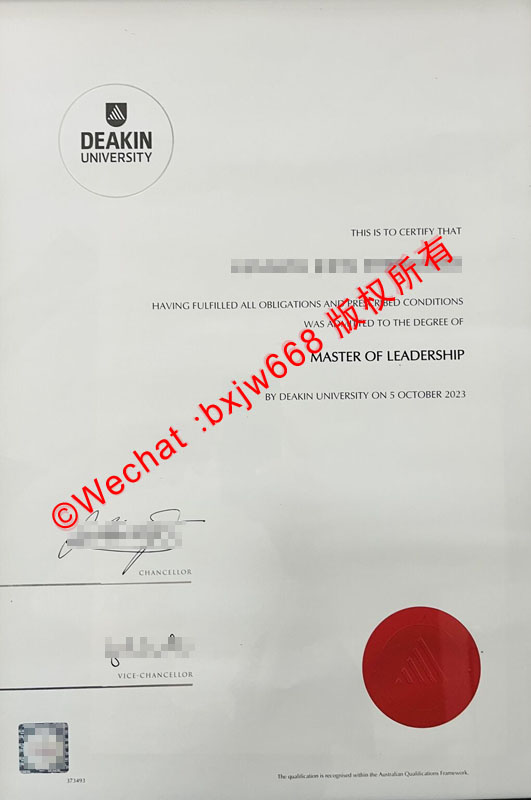

# 加拿大约克大学学位证（York University Diploma）文凭样式解析

对于在加拿大留学的学子而言，**约克大学（York University）**不仅是加拿大规模第三大的顶尖综合性公立大学，更是无数人梦寐以求的学术殿堂。当毕业生顺利修满学分、通过考核后，所获得的约克大学学位证书（Diploma）便是其多年寒窗苦读的最佳见证。

本文将基于约克大学官方颁发的真实硕士学位证书样本，从**视觉排版、核心文字框架、纹章与印章工艺、防伪技术细节**等多个维度进行全方位、深层次的独家解析，帮助大家清晰了解这所北美名校文凭的独特设计美学与防伪权重。

## 约克大学毕业证外观与纸张规格

### 1. 整体视觉印象
约克大学的学位证书整体呈现出一种**极简而庄重**的北美学术风格。它没有采用部分欧洲高校繁复的巴洛克边框设计，而是选择大面积留白，通过优雅的字体排列和标志性的色彩点缀（如左下角耀眼的红印），彰显出现代高等教育机构的严谨与权威。

### 2. 纸张材质与特殊规格
* **纸张类型**：官方文凭采用的是定制的高克重**高白/奶白色特种卡纸（Premium Diploma Stock）**。这种纸张表面带有微细的哑光特殊肌理，不仅吸墨性极佳，而且具有抗老化、不易变黄的物理特性。
* **证书尺寸**：通常采用北美标准的文凭尺寸（如 11 x 14 英寸或接近 A3 尺寸），整体比国内常见的 A4 毕业证更为宽大，便于装裱与长期保存。

## York University文凭核心排版布局与文字框架

通过对上方真实样本的观察，约克大学学位证的文字信息由上至下呈现出清晰的逻辑层级：

### 1. 学校名称（University Name）
位于证书正上方居中位置，采用经典的**衬线体（Serif Font）大写字母**印制：
> **YORK UNIVERSITY**
字形浑厚，间距舒展，具有强烈的视觉冲击力和历史厚重感。

### 2. 授予宣告（The Conferring Clause）
紧随校名下方，是一行较小的说明文字，明确了学位的授予主体及地理位置：
> *The Chancellor and Senate of York University in Toronto, Canada, confer on*
> （位于加拿大托伦托的约克大学校长与参议院，特授予……）

### 3. 毕业生姓名（Graduate's Name）
位于宣告下方核心区域（样本中进行了模糊处理）。官方通常会使用**加粗的无衬线体或现代手写风字体**单独印制毕业生法定英文姓名，确保主体身份一目了然。

### 4. 院系与修读声明（Faculty & Fulfillment Statement）
在姓名下方，进一步阐述该生已满足毕业的所有法定要求：
> *who has completed to the satisfaction of the Faculty of Graduate Studies all the requirements of the course of study appointed by the statutes of the University, the degree of*
> （该生已圆满完成研究生院规定的、大学章程所要求的全部课程修读要求，特授予……学位）

### 5. 学位名称与专业（Degree & Major）
这是整张证书最核心的部分。为了突出学位的重要性，约克大学在此处打破了黑墨印刷的常规，采用了**深红色/玛瑙红（York Red）**进行强调，并使用了极具艺术感的英式手写体（Italic Script）：
> ***Master of Disaster and Emergency Management***
> （灾难与应急管理硕士）
这种红黑撞色的设计，既契合了约克大学的官方代表色（York Red），又让学位的核心信息在视觉上瞬间脱颖而出。

### 6. 权利赋予与日期声明（Rights & Date）
> *and grant all the honours, rights and privileges which appertain to this degree.*
> （并赋予该学位所享有的一切荣誉、权利与特权。）
下方则注明了具体的毕业月份与年份（例如：*April 2023*）。

## 约克大学学位证防伪工艺与核心图腾解析

加拿大高校对文凭防伪有着极高的要求，约克大学的学位证防伪体系主要通过**官方校徽、激光或齿轮红印、高管亲笔签名以及底部发行代码**来实现。

| 防伪要素 | 具体位置 | 工艺与视觉特征 |
| :--- | :--- | :--- |
| **校徽图腾 (Coat of Arms)** | 证书左上角 | 带有格言的盾徽，采用高精度灰色原图层印刷，细节纤毫毕现。 |
| **锯齿红印 (Red Seal)** | 证书左下角 | 标志性烈焰红齿轮印章，多重防伪叠加，边缘锐利。 |
| **高管签名 (Signatures)** | 证书正下方 | 校长（Chancellor）与副校长（President and Vice-Chancellor）组合签名。 |
| **版本代码 (Issued Code)** | 证书最底部居中 | 微型字体印制落款时间及版本编码，如“Issued June, 2023”。 |

### 1. 左上角：约克大学官方校徽（Coat of Arms）
校徽由盾牌、双生白玫瑰以及下方的拉丁文缎带组成。
* **白玫瑰**：象征着约克郡（Yorkshire）的白玫瑰历史渊源。
* **校训缎带**：下方缎带上印有约克大学的拉丁文校训 **“TENTANDA VIA”**（意为：*The way must be tried* / 必须不断尝试）。在正规文凭上，校徽的线条极为细腻，即使是微小的字母在放大镜下也绝不模糊。

### 2. 左下角：标志性锯齿红印（Red Seal）
这是约克大学毕业证最具辨识度的防伪特征。该红印呈现**鲜艳的东方红/烈焰红**，边缘带有密集的**太阳芒状锯齿（齿轮状）**。在部分高端定制或特定年份的文凭中，该红印会配合**重力钢印（Embossed Seal）工艺**压印，使得纸张背面有明显的凹凸感，正面触摸则有明显的立体浮雕感。

### 3. 正下方：校长与副校长双重签名
证书底部并排排布着两位学校最高领导者的签名：
* **左侧**：CHANCELLOR（大学校监/校长）
* **右侧**：PRESIDENT AND VICE-CHANCELLOR（校长兼副校监）
正式文凭的签名均采用高清矢量电子墨水压印，完美还原了手写笔迹的枯笔与力度变化，防伪级别极高。

## 如何辨别加拿大约克大学毕业证的真伪？

随着跨境留学服务的发展，了解如何鉴别海外文凭真伪成为了各大企业 HR 及学术机构的必备技能。鉴别约克大学文凭可遵循“三步法”：

1. **看色彩与套印**：正品文凭的专业名称“Master of...”必须是纯正且饱和度极高的**约克红**，不能有杂色或偏色；左下角红印与文字不能有重叠造成的晕染。
2. **摸质感与边缘**：正品特种纸用手抚摸有微微的涩感和厚重感，四周切割边缘光滑无毛刺。
3. **核对物理日期与发行码**：证书最底部通常有一行极其微小的落款时间（如 *Issued June, 2023*），其年份月份必须与证书正文中的毕业时间相互吻合，且字体规格极小，普通复印机极易出现断线或糊字现象。

### 结语

加拿大约克大学的学位证书（York University Diploma）不仅是一张纸，它融合了高规格的设计美学与严密的防伪技术，体现了北美顶级学府对学术成果的尊重。通过本文对该样本的排版、文字、颜色及防伪红印的深度拆解，相信大家对约克大学的文凭样式有了更为直观和专业的认知。

